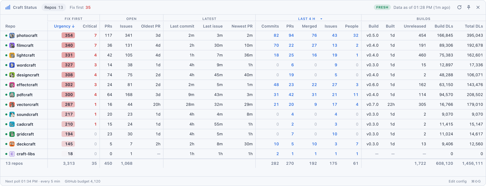

Craft Repo Status App
=====================

Find out the status of the craft apps: a tray dashboard ("Craft Status") that
polls the storytold `*craft` repositories on GitHub every 30 minutes, keeps a
cache, and tells you what to fix first. Everything runs locally: no server.



- **Rust workspace**
  - `craft-core`: the model, release/download accounting, the urgency
    heuristic, config, cache and window state. No network or UI dependencies,
    and it is unit-tested.
  - `craft-github`: the GitHub GraphQL/REST fetcher, plus a `craft-fetch` CLI
    that prints a table, for debugging.
  - `craft-status-app`: the Tauri 2 shell (poll thread, tray, global
    shortcut, window).
- **TypeScript, HTML and CSS** in `ui/`, with no framework or bundler. `tsc`
  compiles `ui/src/` to `ui/build/`, which `index.html` loads; the app's
  `build.rs` runs it, so building the app needs Node.js 24+ and `npm ci`.
  `ui/src/model.ts` is pure; it and the UI itself (in happy-dom) are tested
  with `node --test`. No JavaScript is committed: see `CLAUDE.md`.

## What it shows

Every column sorts. Click a header; click it again to reverse the order. Repos
with no data always sort last. Or drag rows into your own order (say, by
priority): dropping one clears the sort, and the order is remembered until you
sort by a column again.

| Group | Columns |
| --- | --- |
| Fix first | **Urgency** (the sum of the top five open-issue scores) · **Critical** (open issues naming a crash, hang, freeze, data loss, launch failure or security problem) |
| Open | open PRs · open issues · oldest open PR |
| Latest | last commit to `main` · newest issue · newest PR |
| Activity (dropdown) | commits to `main` · PRs opened · PRs merged · issues opened · people committing to `main` |
| Builds | most recent release tag · its publish date · **Unreleased** (commits on `main` since it) · its downloads · downloads across all releases |
| CI | **Main CI** (workflows whose latest result on the default branch failed) |

- **Activity** covers the window picked in that group's header: the last
  10 min, 30 min, hour, 4 h (the default), 12 h, day or week, since the last
  release, or all time. Every fetch gets all nine, so switching is instant;
  the choice is remembered. People are distinct commit authors in the window;
  all time, it is GitHub's contributor count. The numbers are as of the last
  fetch of that repo, so short windows lag by up to `poll_minutes`.
- **Since last release** starts at each repo's own latest build, so the span
  differs per row (hover a number for the release and its date). Its commits
  are the **Unreleased** count; PRs, merges, issues and people count from the
  release's publish date. Repos with no release show `—`.
- **Builds** are GitHub releases. Drafts are ignored. Prereleases count, and
  they carry a `PRE` tag.
- **Unreleased** counts the commits that have landed on `main` since the latest
  build, by comparing its tag with `main`. When the tag's commit isn't on
  `main` (say, a release branch with a version bump), it counts the commits
  since the two split. When they share no history, it counts the `main`
  commits newer than the tag's commit. Both estimates show a `~`. Click the
  number to open the comparison on GitHub.
- **Downloads** add up every OS and package type: dmg, msi, AppImage, deb,
  rpm, flatpak, zips and tarballs. Checksum lists, signatures, `.zsync` delta
  files and updater manifests are left out, because machines fetch them, not
  people.
- **Main CI** reads `✓ 4` when the latest result of each of the repo's four
  GitHub Actions workflows with a result in the last 30 days passed, and
  `✗ 1 of 4` when one failed. A workflow's latest result is its newest
  completed run on the default branch that was not canceled or skipped,
  together with its other runs on the same commit and event that were created
  within a minute of it, for example Dependabot's runs for each package
  ecosystem. Scheduled runs count; pull request runs and disabled workflows
  are left out. Hover the cell for each workflow's result, and click it to
  open the failed run.
- **Fix first** (`⌘2`) ranks open issues across every repo. Each issue shows
  the reasons behind its score. Click a row in the Repos table to filter the
  list to that repo. Click an issue to open it on GitHub.
- **Freshness**: the header shows when the oldest data on screen was fetched,
  and a pill that reads `FRESH`, `REFRESHING` or **`STALE`**. Data is stale
  when any repo has gone `stale_minutes` (default 15) without a successful
  fetch. A stale row is dimmed and gets an amber dot; a failed row gets a red
  dot, and its error appears in the banner. The tray tooltip also says
  whether the data is stale.

### How issues are scored

The score is deterministic and simple to read (`crates/craft-core/src/urgency.rs`):

| Signal | Points |
| --- | --- |
| Crash, panic, freeze, hang, data loss, corruption, won't open or launch, blank screen, security | +40 |
| Broken, but not severe ("doesn't work", error, regression…) | +15 |
| `bug` label | +15 |
| Filed by someone outside the team | +10 |
| Reactions ×3 and comments ×2, log-scaled | up to +40 |
| Names the latest build's version | +10 |
| Opened in the last 24 h | +8 |
| Opened in the last 72 h | +4 |
| Feature request, question or docs nit | −25 |
| Untouched for 30 days | −5 |

Issues labelled `wontfix`, `duplicate` or `invalid` are dropped. For each
repo, the 100 newest open issues and the 30 most-commented open issues are
scored.

## Polling and cache

- The app fetches one repo at a time, 20 s apart: first any repo with no data
  (or data cached by an older build that lacks a column), then whichever repo
  has the oldest data, once it is `poll_minutes` old (default 30). Within a
  repo it pauses after each GraphQL request as long as it took: GitHub allows
  only 60 s of GraphQL server time per minute, and its secondary rate limits
  punish bursts. Each repo costs about six GraphQL requests and one REST
  request. It never uses search, which GitHub limits far more tightly (to
  about 30 a minute); PR and issue counts per window come from walking the
  recent PRs and issues.
- For **Main CI**, each fetch also lists the repo's workflows, then the newest
  20 completed runs of each active workflow on the default branch, reading up
  to 10 pages of them while none holds a result. Each page is requested with
  the ETag of its previous answer, so an unchanged list comes back as 304,
  which does not count against GitHub's primary rate limit. These requests
  are skipped while fewer than 1,500 GraphQL points remain.
- Each repo's icon is `assets/app-icon/hicolor/64x64/apps/*.png` on its default
  branch. It is downloaded once and again only when the file changes; it's
  kept in the cache. Repos without one (libraries) get a lettered tile.
- If fewer than 150 points remain, fetching pauses for 30 minutes. If GitHub
  rate-limits the app, it pauses for 5 minutes, or until GitHub's retry time
  if that is later, doubling up to an hour while the limit persists. A repo
  whose fetch fails (offline, just woke from sleep) is retried after 10
  minutes; the others carry on.
- Timing follows the wall clock, so a laptop that wakes from sleep polls
  within about 15 s.
- `⌘R` or the ⟳ button makes every repo due at once; they are still fetched
  one at a time, stalest first, and a rate-limit pause still holds.
- Two caches in `~/Library/Caches/craft-status/` survive restarts:
  - `raw/<owner>@<repo>.json`: each repo's commit authors, PRs and issues
    from the last week (or since the latest build). Each poll fetches only
    what's new since the previous one, and refetches from scratch every six
    hours to drop deleted issues and pick up late-dated commits. It also
    keeps the ETags and results of the Main CI requests.
  - `snapshot.json`: what the window shows, saved after each repo. On launch
    the window shows it at once, marked `STALE` if it's old. Repos whose
    data is still fresh aren't refetched at launch.
- The GitHub token comes from the first of `$CRAFT_STATUS_GITHUB_TOKEN`,
  `$GITHUB_TOKEN` and `$GH_TOKEN` that is set, then from `github_token` in the
  config, then from `gh auth token`. The app is started by launchd, not a
  shell, so it sees variables set with `launchctl setenv` (then relaunch it),
  not those exported in your shell profile.

## Tray and window

The app behaves like the Todo app:

- It lives in the menu bar, with no Dock icon.
- Left-click the tray icon to show or hide the window. Right-click it to get
  Refresh Now, Always on Top, Edit Config… and Quit.
- `⌘⇧G` shows or hides the window from anywhere.
- The window is chrome-less and semi-transparent, and it appears on every
  Space. It remembers its position and size in `~/.craft_status_state.toml`.
- `Esc` hides the window.

## Configuration: `~/.craft_status_config.toml`

The app creates this file from
[`craft_status_config.template.toml`](craft_status_config.template.toml) the
first time it launches. It re-reads the file before each poll, so edits to the
repo list or the intervals take effect without a restart.

## Build, install, test

Prerequisites:

- Rust stable
- Node.js 24+, then `npm ci` (the UI's TypeScript compiler and test DOM)
- `cargo install tauri-cli --version "^2"`
- Xcode CLT on macOS
- `gh auth login`, or a token in the config

```sh
make install    # release .app → /Applications/Craft Status.app, start at login, launch
make uninstall  # quit, remove the app and the login item (keeps config + cache)
make run        # debug binary
make test       # Rust + UI tests
make check      # clippy + rustfmt + tsc type-check
make snapshot   # fetch once, print a table, write ui/dev-snapshot.json
make preview    # serve ui/ in a browser against that snapshot (no Tauri needed)
```

To start the app at login, `make install` adds
`~/Library/LaunchAgents/ai.storyteller.craft-status.plist`.
